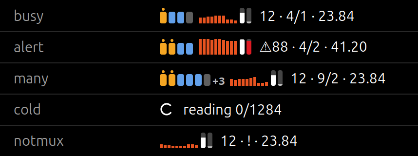
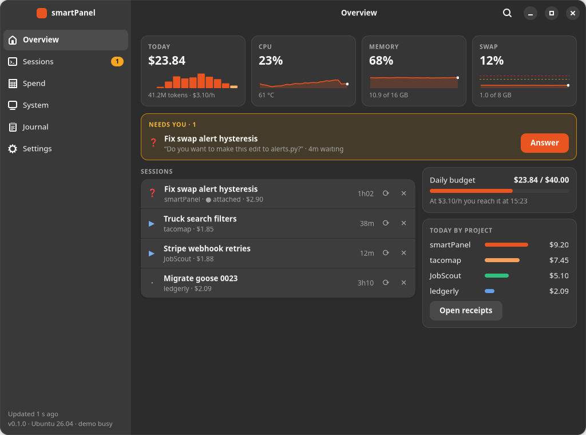
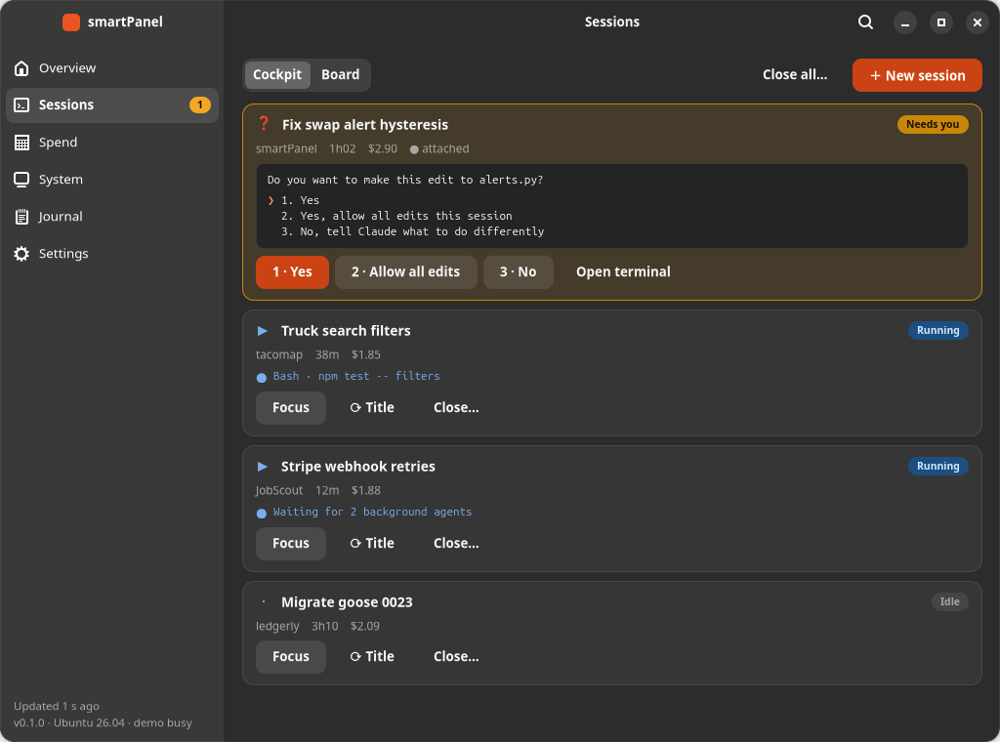
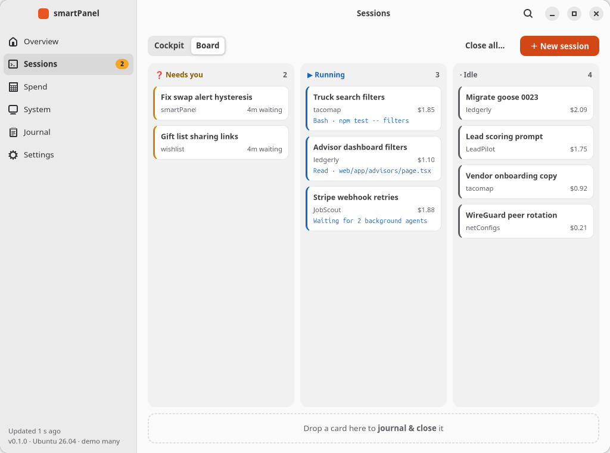
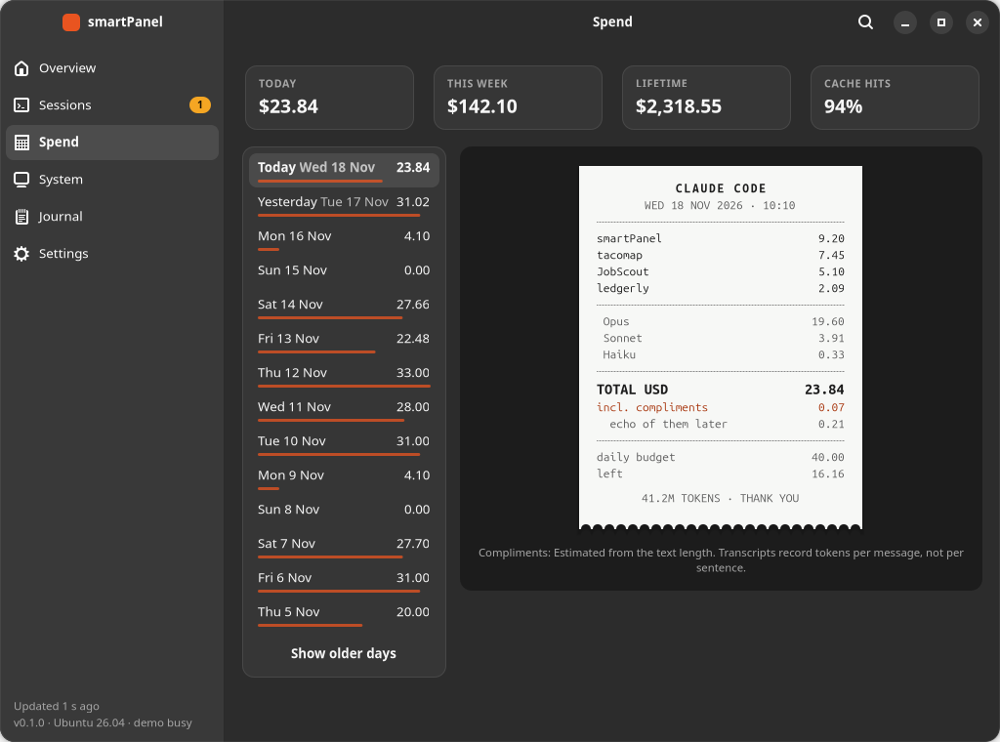
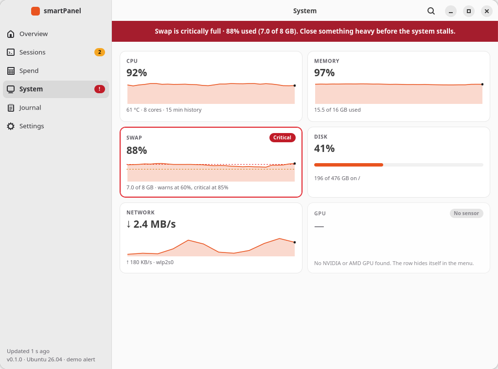

# smartPanel

System metrics, Claude Code spend and Claude session control, in your GNOME top bar.

Inspired by [turing-smart-screen-python](https://github.com/aluzed/turing-smart-screen-python),
but drawn into the Ubuntu panel instead of a USB LCD, and with two things the original
doesn't have: **what Claude Code costs you** (per project, per day, lifetime, read from
the transcripts it already writes) and **the Claude sessions you have running** (see what
each one is doing, answer it, focus it, close it with a journal entry).



The item reads left to right:

- **Session strip**: one block per Claude session. Amber with a dot is *waiting on you*,
  blue is *running*, grey is *idle*, `+3` when there are more than six.
- **Live graphs**: a CPU histogram (last 10 samples), then a white memory meter and a grey
  swap meter (amber, then red, when swap fills up).
- **Numbers**: `swap · sessions/waiting · today's dollars`, e.g. `12 · 4/1 · 23.84`.
  `⚠88` is the swap alert, `!` means tmux isn't installed, `reading 812/1284` is the first
  transcript scan.

Click it for the menu (system, today's spend, the first four sessions, actions);
middle-click opens the dashboard. Settings → Top bar switches each part on or off, or
replaces the numbers with a **ticker** that rotates one reading at a time
(`$23.84 today ●○○○`); an alert pins itself there.

<!-- Dashboard screenshots: run `./scripts/screenshots.sh --readme`, then uncomment.





-->

## Install

Tested on Ubuntu 24.04+ (GNOME, Wayland). Everything comes from apt: no pip, no venv.

```bash
# 1. Dependencies (tmux + terminator are only needed for Claude session management)
sudo apt install python3-gi python3-gi-cairo gir1.2-gtk-4.0 gir1.2-adw-1 python3-cairo \
                 gir1.2-notify-0.7 python3-psutil python3-yaml tmux terminator

# 2. Get the source somewhere permanent. The service runs from this folder.
git clone https://github.com/wehrli/smartPanel.git ~/apps/smartPanel
cd ~/apps/smartPanel

# 3. Install + start (systemd user service, autostarts on login)
./scripts/install.sh            # --dry-run shows what it would do and changes nothing
```

`install.sh` checks the dependencies first and prints the exact `apt` line if anything is
missing. Then it:

- puts `smartpanel` and `claude-tmux` in `~/.local/bin`,
- creates `~/.config/smartpanel/` (settings live in `config.yaml` there),
- installs `~/.config/systemd/user/smartpanel.service` (runs `python3 -m smartpanel`),
- installs a D-Bus service file for `dev.omdev.SmartPanel`, so `smartpanel --dashboard`,
  `smartpanel --palette` and the HUD start the app through systemd when it isn't running,
- turns journal-on-close off if you have no `/journal` skill in `~/.claude` (see below).

Run it again after updating the folder. `./scripts/uninstall.sh` removes all of it and
keeps your settings. Logs: `journalctl --user -fu smartpanel`.

On non-Ubuntu GNOME (Fedora, Arch, vanilla GNOME), install the AppIndicator extension
first: <https://extensions.gnome.org/extension/615/appindicator-support/>.

To build the shareable tarball from a checkout: `./scripts/package.sh` →
`dist/smartpanel-<version>.tar.gz`.

## How it works

One Python process, GTK 4 + libadwaita, no GTK 3 and no AppIndicator library:

1. **Collectors and services** poll the system (psutil), scan `~/.claude/projects/*.jsonl`
   on a thread, and watch tmux. They write one shared state (`smartpanel/state/`).
2. **The top-bar item** speaks StatusNotifierItem + DBusMenu over D-Bus itself. The graphs
   and strip are a wide PNG drawn with cairo; the numbers are the item's text label.
3. **The dashboard, palette and dialogs** are GTK 4 / libadwaita windows on the same state.
4. **`dev.omdev.SmartPanel1`** on the session bus exposes the state and every action, for
   the CLI verbs, the HUD extension and your own scripts.
5. **The desktop HUD** is an optional GNOME Shell extension reading that D-Bus API.

## The dashboard

`smartpanel --dashboard [PAGE]`, middle-click on the item, or *Open dashboard* in the menu.
Pages: **Overview**, **Sessions** (a cockpit list, or `sessions:board` for a board by
state), **Spend** (daily receipts, budget, forecast), **System**, **Journal** (one receipt
per closed session, `journal:<id>` opens one), **Settings**. `Ctrl+1`…`Ctrl+6` switch
pages, `Ctrl+W` closes the window, `Ctrl+K` opens the palette.

## Command palette

Type to find any session, page or action: focus a session, answer its prompt, close it,
start a new one, toggle the HUD, jump to a page.

- **In the window**: `Ctrl+K`.
- **Anywhere**: `smartpanel --palette`. Wayland doesn't let an app grab a global key, so
  bind it yourself: GNOME Settings → Keyboard → View and Customize Shortcuts → Custom
  Shortcuts → `+`, command `smartpanel --palette`, shortcut **Ctrl+Alt+Space** (the
  default the menu shows; change `palette.shortcut` if you pick another).

## Settings

Edited in the Settings page; stored in `~/.config/smartpanel/config.yaml`. An environment
variable, where there is one, wins over the file.

| Key | Default | Env var | What it does |
|---|---|---|---|
| `bar.strip` | `true` | | One block per session in the top bar |
| `bar.graphs` | `true` | | CPU histogram, memory and swap meters |
| `bar.text` | `true` | | `swap · sessions/waiting · today's dollars` |
| `bar.ticker` | `false` | | Rotate one reading at a time instead of the numbers |
| `bar.ticker_seconds` | `5` | | Ticker period |
| `swap.warn` | `60` | `SMARTPANEL_SWAP_WARN` | Percent at which the swap warning starts |
| `swap.crit` | `85` | `SMARTPANEL_SWAP_CRIT` | Percent at which it turns critical |
| `swap.hysteresis` | `5` | `SMARTPANEL_SWAP_HYSTERESIS` | Points below a line before stepping back down |
| `swap.repeat_s` | `600` | `SMARTPANEL_SWAP_REPEAT` | Seconds before a sustained critical repeats (`0` = never) |
| `budget.daily_usd` | off | | Daily budget, shown on Overview and every receipt |
| `notifications.budget` | `true` | | Notify when today goes over budget |
| `sessions.journal` | `true` | | Run `/journal` in a session before closing it |
| `sessions.min_age_s` | `120` | `SMARTPANEL_JOURNAL_MIN_AGE` | Younger sessions close without a journal |
| `sessions.confirm_seconds` | `5` | | The journal dialog says yes on its own after this |
| `sessions.reattach` | `true` | `SMARTPANEL_FOCUS_REATTACH` | Re-attach in a new terminal when focus can't raise one |
| `sessions.dir` | `~/dev/omdev` | `SMARTPANEL_SESSIONS_DIR` | Where the new-session folder picker opens |
| `sessions.terminal` | `terminator` | `SMARTPANEL_TERMINAL` | Terminal for new sessions and re-attach |
| `disk.mount` | `/` | | Disk shown on the System page |
| `hud.enabled` | `false` | | Desktop HUD on/off |
| `hud.corner` | `top-right` | | `top-left`, `top-right`, `bottom-left`, `bottom-right` |
| `hud.margin` | `30` | | HUD distance from the screen edge, px |
| `appearance.style` | `system` | | `light`, `dark`, or follow GNOME |
| `palette.shortcut` | `<Ctrl><Alt>space` | | The shortcut the menu advertises (bind it in GNOME, above) |

## Desktop HUD (optional)

Today's spend, up to six sessions with their state, CPU / memory / swap / network and the
swap alert, drawn on the wallpaper behind every window. It's a GNOME Shell extension
(`smartpanel-hud@omdev.dev`) that reads the app over D-Bus:

```bash
./scripts/install-hud.sh        # then log out and back in (Wayland)
gnome-extensions enable smartpanel-hud@omdev.dev
smartpanel --hud on             # or the menu's "Desktop HUD", or Settings
```

Details in `extension/smartpanel-hud@omdev.dev/README.md`.

## Demo mode

Every screen runs on simulated data, without touching tmux, your transcripts or your
settings file:

```bash
python3 -m smartpanel --demo busy       # also: calm alert empty many cold first notmux noswap
python3 -m smartpanel --demo gallery    # every widget of the UI kit
python3 -m smartpanel --demo alert --snapshot system --out /tmp/system.png --style dark
./scripts/screenshots.sh                # every page × scenario × light/dark → docs/screenshots/all/
```

`--snapshot` renders offscreen (a private Broadway display), so it works over SSH and
never shows a window.

## Themes

`--theme default` (the default) and `--theme claude-focus` are built in; `--theme
/path/to/theme.yaml` loads your own. The YAML is a subset of the turing-smart-screen theme
format, so an existing theme drops in (pixel-layout fields are ignored); its `INTERVAL`s
set how often each category is polled.

**Top-bar precedence:** if a theme sets `smartpanel.top_bar_format`, that template is the
bar's text and replaces the numbers / ticker (the strip and graphs still follow Settings).
The shipped presets don't set one, so they use the composition above. Templates use the
v1 names:

```yaml
smartpanel:
  top_bar_format: "{SWAP.STATUS} · {SESSIONS.STATUS} · ${CLAUDE.COST_TODAY:,.2f}"
  # renders as: 🔃12% · 🧩4 ❓1 ▶2 · $23.84
```

Available: `SWAP.STATUS` / `SWAP.ALERT` / `SWAP.PERCENTAGE`, `CPU.PERCENTAGE` /
`TEMPERATURE`, `MEMORY.PERCENTAGE`, `DISK.USED_PERCENT`, `NET.DOWNLOAD` / `UPLOAD` (MB/s),
`GPU.PERCENTAGE`, `CLAUDE.COST_TODAY` / `COST_WEEK` / `COST_LIFETIME` / `BURN_RATE` /
`TOKENS_TODAY_HUMAN` / `CACHE_HIT_RATIO`, `SESSIONS.STATUS` / `COUNT` / `WAITING` /
`RUNNING`. A template that doesn't place `{SWAP.…}` still gets the swap alert prefixed
(`🔴🔃88% …`), because GNOME truncates labels from the right.

## Swap alert

A full swap partition is the point where a Linux desktop stops being busy and starts
thrashing, and it's invisible in the usual readouts: RAM has been pinned at 100% for a
while by then. smartPanel watches it and says so:

- **In the bar**: the swap meter turns amber, then red, and the number gets a `⚠`
  (`⚠88 · 4/2 · 41.20`). With the ticker on, `⚠ Swap 88%` pins itself.
- **As a notification**, once on the way up and once when it's back to normal.
- **In the dashboard**, a banner above every page.

It doesn't nag. Entering a level notifies once; a *sustained* critical repeats every
`swap.repeat_s`; dropping from critical to warning is silent; crossings use a
`swap.hysteresis` band so swap hovering on a line can't flicker. A machine with no swap
shows `—` and never alerts. Notifications go through libnotify, then `notify-send`, then a
log line; a missing notification daemon never breaks the panel.

## Claude spend

smartPanel reads `~/.claude/projects/<encoded-path>/*.jsonl`, the transcripts Claude Code
already writes. No setup, no API calls. It shows spend today / this week / lifetime, burn
rate, tokens, cache hit ratio, per project and per model, and a forecast against your
budget. The first scan of a large history runs on a thread with progress in the bar
(`reading 812/1284`); after that only changed files are re-read.

Costs are **estimates** from the per-model rates in `smartpanel/claude_stats/pricing.py`
(Opus / Sonnet / Haiku, matched by model-id prefix; unknown models are priced as Opus).
Update it when Anthropic changes pricing.

## Gratification counter

How much are you paying for "Good question", "You're absolutely right", "Great goal —
that's the right thing"? smartPanel finds gratification in the assistant's prose, sizes it
in tokens and prices it:

```bash
smartpanel --praise-report      # one-shot, no display needed (works over SSH)
```

```
            phrases    tokens    written     echoed      total   of spend
today             7       111    $0.0083      $0.01      $0.02      0.01%
week             11       189      $0.01      $0.01      $0.03      0.00%
lifetime         66      1.0k      $0.08      $0.11      $0.19      0.01%
```

- **written** is the output tokens spent saying it; **echoed** is every later turn
  re-sending it as prompt, at the cache-read rate (usually the larger half).
- Only assistant **prose** counts: thinking, tool calls, code and quotations are excluded.
  A short sentence containing a compliment is charged whole; a long one that merely opens
  with one, only its opening clause.
- Tokens are **estimated** (~4 chars/token): transcripts record output tokens per message,
  never per sentence. Treat it as an order of magnitude, not a bill.

The phrase table at the top of `smartpanel/claude_stats/flattery.py` is meant to be edited.

## Claude sessions

smartPanel sees and controls Claude Code sessions that run inside tmux, started with the
bundled launcher (or the *New session…* button):

```bash
claude-tmux                     # tmux session "claude-<folder>", in the current folder
claude-tmux -n review           # "claude-review"
claude-tmux --model opus        # extra args go to `claude`
```

Only tmux sessions named `claude-…` are ever listed or closed; your other tmux work is
never touched. Sessions started with plain `claude` are invisible by design.

**What each one is doing**, read from its tmux pane (a permission prompt never reaches the
transcript, so the pane is the only place it exists):

| Glyph | State | Meaning |
|---|---|---|
| ❓ | waiting | Blocked on **you**: a permission prompt, a plan approval, a question. You can answer it from the dashboard or the palette. |
| ▶ | running | Generating, running a tool, or waiting on a background agent. |
| · | idle | Nothing happening. |

**Clicking a session** brings its terminal forward. GNOME Wayland doesn't let one app
raise another's window, so smartPanel tries, in order: `SMARTPANEL_FOCUS_CMD` (your
command, `{session}` / `{title}` placeholders); the
[Window Calls](https://extensions.gnome.org/extension/4724/window-calls/) extension, the
one route that raises in place on Wayland; `wmctrl` / `xdotool` on X11; and finally a
**re-attach**: a fresh terminal running `tmux attach -d`, which closes the old window, so
you keep exactly one per session. tmux owns the screen and scrollback, so nothing is lost.
Turn the last step off with `sessions.reattach`.

### Journal on close

Closing a session offers to journal it: a dialog that says yes on its own after
`sessions.confirm_seconds`. Sessions younger than `sessions.min_age_s` just close.

On yes, smartPanel **types `/journal <project>` into the running session** and closes it
only once the skill answers. Running it live, rather than killing first and replaying the
transcript, means the skill sees the actual conversation and can record *why* things were
decided. The skill decides where the entry goes (yours appends to a monthly log) and
returns one confirmation line.

smartPanel also writes a receipt to `~/.claude/smartpanel/journals/<ts>-<project>.md`: that
line plus a deterministic Activity section (duration, files, commands, tool counts), so a
failed skill still leaves a record. The session is always closed, even if journaling
fails. If the session already exited on its own, it falls back to a headless
`claude -p --resume <id>`.

`claude-tmux` starts sessions in `--permission-mode acceptEdits`, because the live route
inherits the session's mode: in manual mode the skill's `git` sweep and file write would
sit on a prompt nobody is watching until the timeout.

| Env var | Default | What it does |
|---|---|---|
| `SMARTPANEL_JOURNAL_SKILL` | `/journal` | Slash command to run (project appended). Empty = off. |
| `SMARTPANEL_JOURNAL_TOOLS` | `Bash Read Write Edit Glob Grep Task TodoWrite` | Tool allowlist for the headless fallback |
| `SMARTPANEL_JOURNAL_MODEL` | the session's | Model for the headless fallback |
| `SMARTPANEL_JOURNAL_TIMEOUT` | `300` | Seconds before a run is abandoned |
| `SMARTPANEL_JOURNAL_IDLE_WAIT` | `120` | Seconds to wait for a busy session to go idle first |
| `SMARTPANEL_CLAUDE_PERMISSION_MODE` | `acceptEdits` | Mode new sessions launch in (empty = no flag) |
| `SMARTPANEL_FOCUS_CMD` | unset | Focus command tried first |

Journal runs are serialized: *Close all* journals one session at a time so they don't
clobber the shared log, and each stays up until its own entry is written.

## Command line

```
smartpanel                      start (or, if running, open the dashboard)
smartpanel --dashboard [PAGE]   open the dashboard on PAGE
smartpanel --palette            open the command palette
smartpanel --hud on|off|toggle  show or hide the desktop HUD
smartpanel --demo SCENARIO      run on simulated data
smartpanel --theme NAME|PATH    theme preset or .yaml
smartpanel --praise-report      print the gratification report and exit (no display)
smartpanel --snapshot PAGE --out FILE.png [--demo S] [--style light|dark] [--size WxH]
```

A second `smartpanel …` is forwarded to the running instance.

## License

MIT.
