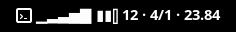

# ADR 0002: Graphics in the top bar (D2, SP-0002)

Status: accepted.

## Context

The design puts small coloured graphics in the GNOME top bar, without a Shell extension
of our own: the A6 session strip, the A4 CPU histogram and the memory and swap meters.
These go next to the A1 text (`12 · 4/1 · 23.84`). The only drawing surface is what the
stock Ubuntu AppIndicator extension (`ubuntu-appindicators@ubuntu.com`) shows for a
StatusNotifierItem: one icon and one text label.

## Options

Each option below was captured in a real GNOME Shell 50 panel with the stock extension,
from the `busy` demo scenario. To reproduce: `scripts/capture_bar_options.sh`
(a headless shell on a private bus, so nothing is touched in the running session).

1. **Wide PNG named by absolute path.** `IconName` is an absolute path to a cairo
   PNG whose width is at least 1.5 times its height, in a user-writable directory. The
   host's `_loadCustomImage` ("Hello indicator-multiload!") keeps the aspect ratio.

   

2. **The same image as `IconPixmap`.** The host forces pixmaps into a square icon box,
   so the strip is squashed to an unreadable smudge.

   

3. **Unicode in the label.** The graphics are faked with block characters (`▁▂▃▅▇`
   histogram, `▮▮▯` strip) in `XAyatanaLabel`. It is readable, but it is monochrome. It
   also costs label width, and the panel truncates long labels from the right.

   

Refresh: the host re-reads the icon on `NewIcon`. A path it has already loaded can be
served from St's texture cache, so the file name must change whenever the image does.

## Decision

Option 1 ships. `smartpanel/tray/barrender.py` draws the strip, the histogram and the
meters with pycairo to `$XDG_RUNTIME_DIR/smartpanel/bar-<hash>.png`, and `IconName`
points at it. A content hash per distinct image defeats the texture cache. `IconWriter`
keeps only the current and the previous file. The A1/A5 text stays in `XAyatanaLabel`.

The fallback is plain text. When there is nothing to draw (`bar.strip` and
`bar.graphs` both off, or no sessions and no graphs) or the PNG fails to render, the
item shows the themed `utilities-terminal-symbolic` icon and the text label. Pixmaps
are never used.

## Consequences

- The icon is re-rendered only when its content changes (`IconSpec` equality). There is
  no fixed refresh rate, so a steady panel writes no files.
- `NewIcon` is emitted only when the path or its description changes. Live readings
  are kept out of the icon description (`barspec.icon_desc`) so a changing number
  doesn't reload the image on every tick.
- The behaviour depends on the private `_loadCustomImage` path of one extension. If a
  later version drops it, the item still works and only the graphics are lost.
- `docs/screenshots/bar.png` (from `scripts/bar_preview.py`) is a pycairo
  approximation of the item per scenario. The captures above are the real panel.
